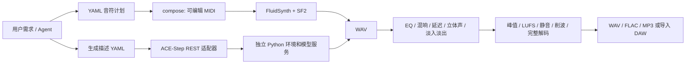

# 系统架构

## 边界

工程根目录为本仓库的 checkout 目录，产品名称 AI Music Studio。没有游戏项目依赖。两条流水线仅共享配置、日志、音频检测和导出接口：

`src/music_studio/` 下 composition、midi、synthesis、generation、mixing、mastering、export 分工独立。基础环境没有 torch、CUDA、vLLM 或模型下载代码。生成服务停止或缺失时，A 仍正常运行。完整音频可以导入 DAW，但平台不提供无损音频转 MIDI。

## 稳定接口

| 边界 | 输入 | 输出 / 失败处理 |
|---|---|---|
| composition.compose | schema_version=1 的 YAML mapping | type-1 MIDI；先验证所有音符再写文件 |
| synthesis.render | 同步 MIDI、已注册 SF2、采样率、增益、尾音 | PCM24 双声道 WAV；真实 native API、拒绝缺失音色及削波 |
| generation.GenerationEngine | health() / generate(plan, output) | WAV + 任务回执；独立本机 HTTP 服务 |
| mixing.mix | 音频和 effects YAML | 新 WAV；超范围或削波失败 |
| mastering.analyze | 音频路径 | JSON 测量结果和 quality_passed |
| export.convert | 音频、格式、MP3 码率 | 新文件、ffprobe 元数据及完整解码结果 |

音符计划字段：`bpm`、`bars`、`time_signature: [4,4]`、`tracks`。每条轨道有独立的 MIDI `channel`（0–15）、`program`（0–127，零起算）、`bank`、`pan` 和 `notes`。每个事件使用 `beat`、`duration`（四分音符拍）、`pitch` 或 `pitches`、`velocity`（1–127）。`repeat_each_bar: true` 重复单小节模板，`bar_transpose` 是循环使用的半音位移列表。默认直接使用绝对拍位置；不自动推断旋律、和声或复杂结构。

MIDI 保留 tempo 和拍号，渲染支持 tempo 变化、音符、program/bank、CC（包括 sustain）、pitch bend、channel/key pressure。银行号按 MSB×128+LSB 解释，使用 SF2 实际 bank/program；没有的音色明确失败。异步 type-2 MIDI 不支持；其他事件列入 unsupported_messages。释放时关闭 sustain、发送 all_notes_off，并输出可配置尾音。长释放/长混响需增加 `--tail`，效果使用已有缓冲尾部。

音源 registry 支持外部绝对路径或 `${变量}`（Windows 也可 `%变量%`），不需要放进仓库。每个音源保存 format、author、source、license、sha256。SF2 加载时重新验证哈希并枚举实际音色；SFZ 目前仅注册，不宣称具备宿主能力。生产阶段可换高质量采样库，先核实其授权。

## 运行状态与限制

所有命令 stdout 是 `schema_version/run_id/command/status/result/error/log_path` JSON；日志 stderr 和 `outputs/logs/{run_id}.log`，同名 `.json` 保存结果。帮助输出为文本。退出码 0 成功、2 参数/执行错误、3 音频质量或核心就绪检查失败、130 中断。全局 `--settings` 必须放在子命令之前。

路径基于工程根目录，`MUSIC_STUDIO_HOME` 可指定根目录。`config/local.yaml` 替代整份默认配置，避免深层合并产生意外音源或服务设置。所有音频输出拒绝覆盖；失败渲染可能保留未完成文件，必须根据运行状态判断，不能凭文件存在判成功。

质量门：静音、任一静音声道、非有限值、削波、超过 0 dBTP 的估算峰值及极短音频。LUFS 使用 pyloudnorm 的 integrated_loudness；真峰值为 4 倍重采样估算，不等于认证仪表。DSP 混响是确定性合成脉冲响应，EQ 为 RBJ peaking biquad；没有“专业母带已完成”的主观保证。内存式混音/检测有一小时时长上限，长音频需分段或后续流式实现。

ACE-Step 适配按官方异步接口提交任务、轮询及下载 WAV；只允许 loopback origin，不自动启动/安装服务。任务提交后立即保留 `.task.json`；超时不自动重复提交。启用 `generate` 后仍执行实际音频检测，服务返回成功不能替代 QC。HTTP 契约已通过模拟测试，真实模型推理另行验证。
